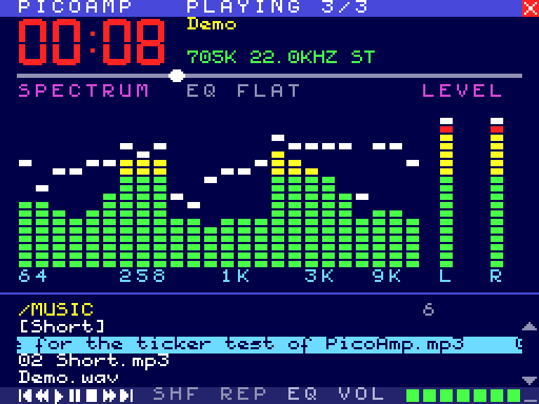
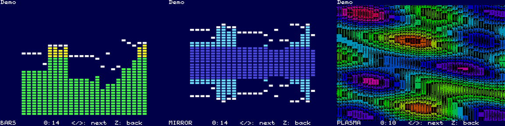

# PicoPlay & PicoAmp for the MSX PicoVerse 2350

Music players for the [MSX PicoVerse 2350](https://github.com/cristianoag/msx-picoverse-public)
cartridge. The cartridge's RP2350 plays MP3 and WAV files from its microSD card and MP3 internet
radio over its ESP-01 itself. The MSX only browses, controls playback and draws.



[](https://msx.pics/image/x5IYH) [](https://msx.pics/image/x5qvI)


| What | For | What it is |
|------|-----|------------|
| **PicoVerse Audio Engine** | RP2350 firmware | Decoding (MP3/WAV), internet radio, the Radio Browser station directory, a 5-band equalizer, the spectrum/VU/scope data. The MSX talks to it through a 4 KB memory window |
| **PICOAMP** | MSX2 | A full-screen Winamp/MUBScope-style player: a 24-band spectrum analyser, oscilloscope, equalizer screen, full-screen pictures, station search, favourites, mouse, help page. Two builds: `PICOAMP.COM` (MSX-DOS 2 / Nextor) and `PICOAMP.ROM` (a cartridge ROM that boots straight into the player) |
| **PicoPlay** | SymbOS 4.0 | A windowed player with folders, play lists, internet radio, the station directory, favourites and an equalizer |
| **PVTEST** | MSX-DOS | A quick check of the cartridge from the prompt, and a small player |

PicoAmp is also published as third-party firmware in the PicoVerse repository:
[`firmware/third-party/2350/picoamp_by_Jzzy_v1.0.uf2`](https://github.com/cristianoag/msx-picoverse-public/tree/main/firmware/third-party/2350)
(the same file as `bin/picoamp_wifi.uf2` here).

## Downloads (`bin/`)

| File | What |
|------|------|
| `picoamp_wifi.uf2` | **PicoAmp**: flash it and the MSX2 boots into PICOAMP. With the ESP-01 WiFi (internet radio) |
| `picoamp.uf2` | the same without WiFi |
| `picoplay_wifi.uf2` | **PicoPlay** firmware: Nextor (Sunrise IDE on the microSD), the 1 MB mapper, the engine and the WiFi, for SymbOS / MSX-DOS with `PICOPLAY.EXE`, `PICOAMP.COM`, `PVTEST.COM` |
| `picoplay.uf2` | the same without WiFi |
| `PICOAMP.COM`, `PICOAMP.ROM` | the MSX2 player for MSX-DOS, and as a 16 KB cartridge ROM |
| `PICOPLAY.EXE` | the SymbOS player |
| `PVTEST.COM` | the MSX-DOS test tool |
| `RADIO.M3U` | a few internet radio stations to start with |
| `loadrom.exe` | Cristiano's LoadROM tool (Windows) with the two extra modes: `-pa` PicoAmp, `-p1` PicoPlay (add `-w` for WiFi) |
| `SHA256SUMS` | checksums |

Flash a `.uf2` as any PicoVerse firmware: hold BOOTSEL, plug in USB, and copy the file to the
RP2350 drive. Put your music anywhere on the card's first (FAT16) partition. For internet radio
the ESP-01 must already know your access point (as for the Nextor WiFi tools).

## Documentation

* [`docs/picoplay.md`](docs/picoplay.md): the engine, PicoPlay, PVTEST, internet radio and the
  station directory, the register window for developers.
* [`picoamp/README.md`](picoamp/README.md): PICOAMP's screens, keys, mouse, favourites, search,
  full-screen pictures, and how it is built and tested.
* [`docs/picoamp-explorer.md`](docs/picoamp-explorer.md): putting PicoAmp into the PicoVerse
  Explorer firmware (slot layout, bus rules, engine entry points, memory).

| Spectrum | PicoPlay in SymbOS |
|---|---|
|  | [](https://msx.pics/image/x56Ke) |

## What is in this repository

| Folder | What |
|--------|------|
| `engine/` | the PicoVerse Audio Engine (`pva_*.c`), with its PC test (`tests/`: a simulated ESP-01, radio servers and Radio Browser API, 269 checks) |
| `picoamp/` | PICOAMP (Z80, sjasmplus), its Z80 test harness, screen tools and mock-ups |
| `picoplay/` | PicoPlay (SymbOS C Compiler) and PVTEST (sjasmplus), their PC tests, and an openMSX device that runs the engine (`emu/`) |
| `devrig/` | a headless openMSX test bench (NMS 8245 + the cartridge's slot layout). The system ROMs it needs are not included |
| `firmware/` | our changes to Cristiano's LoadROM firmware and tool, as a patch: the bus loop with the engine, ROM types 22 (PicoPlay) and 23 (PicoAmp), the tool's `-p1` / `-pa` options. It also carries the SE-ONE emulation, which shares those files |
| `bin/` | the binaries above |
| `assemble.sh` | puts it all together with the PicoVerse repository, for building |

Only our own work is here. The rest of the firmware (the LoadROM bus code, Nextor, the
mapper, the WiFi bridge, the PC tool) is Cristiano's and lives in
[msx-picoverse-public](https://github.com/cristianoag/msx-picoverse-public).

## Building

PICOAMP and PicoPlay build on their own:

```sh
sh picoamp/build.sh                                   # PICOAMP.COM, PICOAMP.ROM (needs sjasmplus, python3)
make -C picoplay SCC=<scc>/bin SJASMPLUS=sjasmplus    # PICOPLAY.EXE, PVTEST.COM
```

The firmware, the LoadROM tool and the tests need the PicoVerse tree. `assemble.sh` fetches
Cristiano's repository at the tested commit, applies `firmware/*.patch` and copies this
repository's folders into their places:

```sh
./assemble.sh                     # -> ./upstream (not in git)
cd upstream/2350/software/loadrom.pio/pico/loadrom
ln -s <no-OS-FatFS-SD-SDIO-SPI-RPi-Pico> <picomp3lib> lib/   # as for LoadROM itself
cmake -S . -B build -G Ninja -DPICO_SDK_PATH=<pico-sdk 2.2.0> -DPICO_EXTRAS_PATH=<pico-extras> \
      -DPICO_BOARD=pimoroni_pga2350 -DCMAKE_BUILD_TYPE=Release
ninja -C build                    # -> dist/loadrom.bin
cd ../../tool && make             # embeds it: loadrom.exe (on Linux: gcc src/loadrom.c)
loadrom -pa -w -o picoamp_wifi.uf2
```

* Libraries: [no-OS-FatFS-SD-SDIO-SPI-RPi-Pico](https://github.com/carlk3/no-OS-FatFS-SD-SDIO-SPI-RPi-Pico)
  and [picomp3lib](https://github.com/ikjordan/picomp3lib) (Helix MP3), the
  [Pico SDK 2.2.0](https://github.com/raspberrypi/pico-sdk) and
  [pico-extras](https://github.com/raspberrypi/pico-extras).
* Engine test: `make -C upstream/.../pvaudio/tests host_pva && ./host_pva <folder with cbr128_v23.mp3>`.
* After working in `upstream/`, `./assemble.sh --back` copies the four folders back here.
* `UPSTREAM_REV=main ./assemble.sh` tries the newest PicoVerse instead of the tested commit.

## Credits and licence

By **JZZY & Claude**, 2026, on the MSX PicoVerse by **Cristiano Goncalves (The Retro Hacker)**.
The engine uses the Helix MP3 decoder (picomp3lib) and FatFs.

Licensed as the PicoVerse project: [Creative Commons Attribution-NonCommercial-ShareAlike 4.0](LICENSE.txt).
