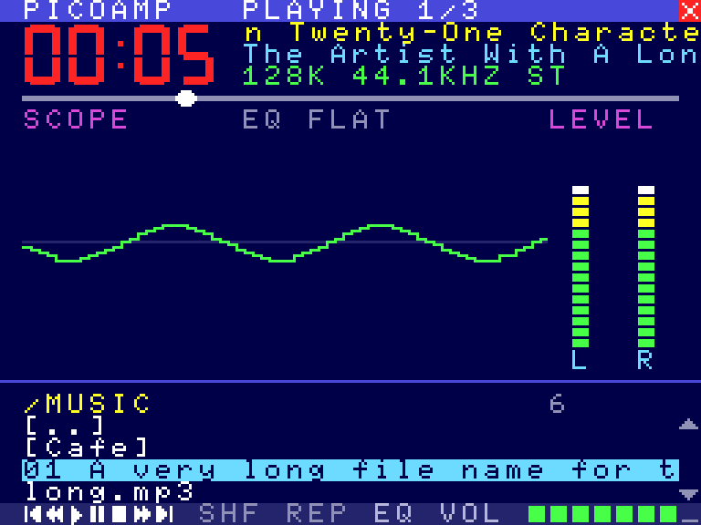
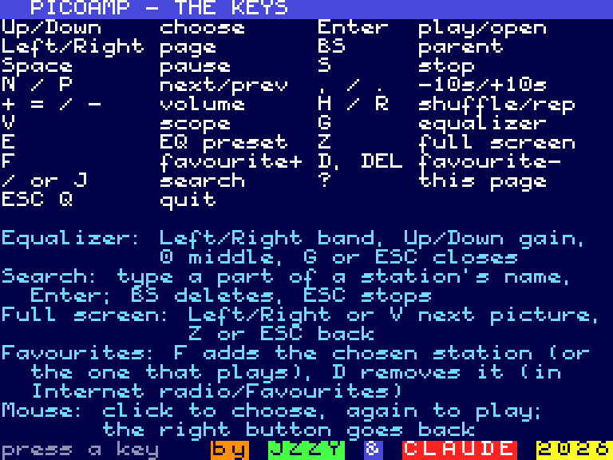
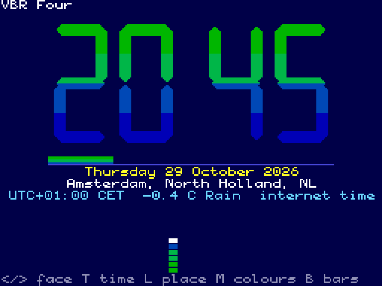
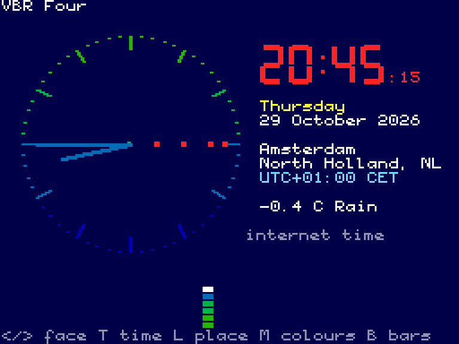
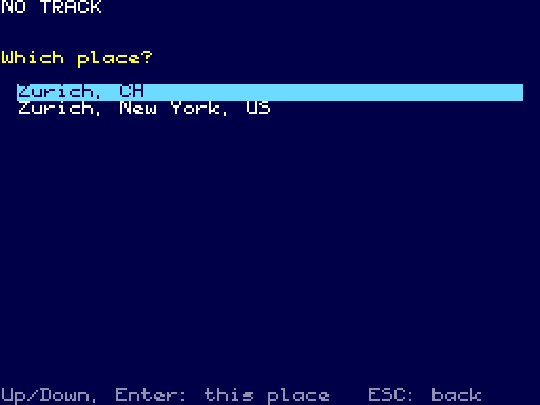
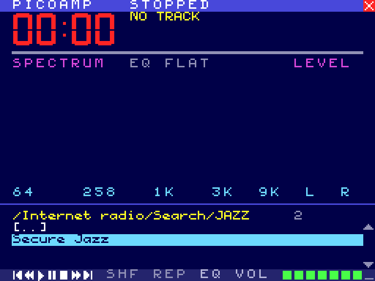
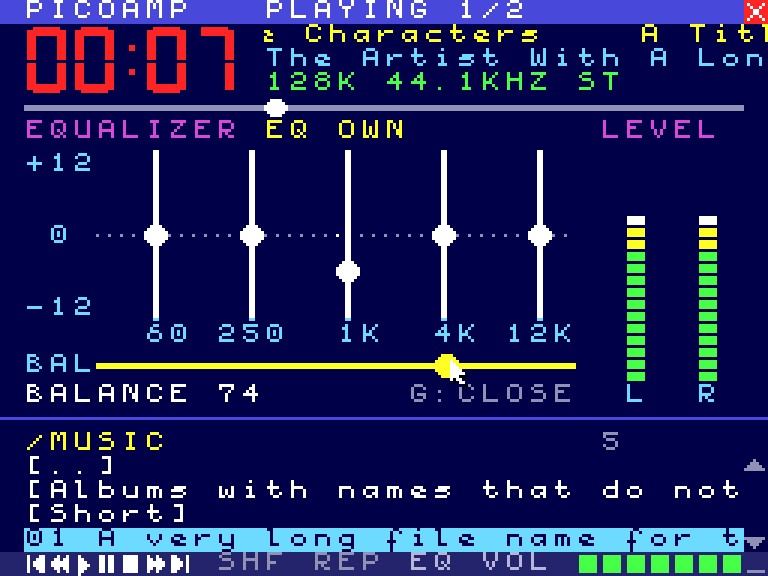

# PICOAMP – MSX-DOS player for the PicoVerse Audio Engine

PICOAMP is a full-screen MP3/WAV and internet radio player for MSX-DOS. It
looks like a mix of Winamp and the MUBScope player. It needs an **MSX2** and a
PicoVerse 2350 cartridge running the PicoPlay firmware (Audio Engine 0.8 or
newer; 0.9 for the station search, 0.11 for the clock's internet time). The engine does the decoding, the equalizer and the sound analysis.
PICOAMP only copies the data and draws it.


| Oscilloscope (V) | Equalizer (G) |
|---|---|
|  |  |

| Full screen (Z): bars, mirror, plasma | Help (?) |
|---|---|
|  |  |

| Clock (C): digital | Clock: analog |
|---|---|
|  |  |

## Running it

Two builds of the same program:

* `PICOAMP.COM` for MSX-DOS 2 / Nextor, with the PicoPlay firmware
  (`loadrom -p1 -w`).
* `PICOAMP.ROM`, a 32 KB cartridge ROM (two 16 KB banks), with the PicoAmp firmware
  (`loadrom -pa -w`): the MSX boots straight into the player, without Nextor.
  It copies itself to RAM at 8000h and reads the keys through the BIOS; Q
  goes back to the BIOS (and on to BASIC). F and D change the favourites
  through the engine (below). See `docs/picoamp-explorer.md` for putting it in
  the Explorer.


```
PICOAMP            start in the root folder of the card
PICOAMP /MUSIC     start in a folder
```

The engine is found by itself in any slot, as PVTEST and PicoPlay do.

## Screen

| Area | What it shows |
|------|---------------|
| Title bar | State (PLAYING / PAUSED / STOPPED), position in the playlist, a close box for the mouse |
| Big digits | Elapsed time |
| Info lines | Title, artist (the station for radio), then bit rate, sample rate and mono/stereo (or "BUFFERING 40%") |
| Seek bar | Position in the track; for radio, how full the buffer is |
| Picture | Spectrum: 24 bars from 60 Hz to 16 kHz on a log scale, 2 dB a step, with falling peak dots. Or the oscilloscope, or the equalizer |
| Level | VU meters, left and right |
| List | The folder or radio list, with the path, the number of entries and page arrows |
| Bottom row | Control icons, SHF / REP (green when on), EQ, volume |

Titles, artists, the format line, the path and the list are in 6-pixel text
(42 characters a screen row; the MSX font is drawn for 6-pixel cells). A title,
artist, station or file name that is longer than its place still stands
still for a second and then scrolls like a news ticker, round and round. One
text moves at a time (the title first, then the artist, then the chosen list
entry), so the rest of the screen stays smooth. Moving through the list gives
the turn to the entry you are on.

The internet radio folders (countries, genres, decades, favourites) work as in
PicoPlay. While the engine fetches a list from the Radio Browser directory,
PICOAMP shows "LOADING THE LIST...".

## Keys

| Key | Action |
|-----|--------|
| Up / Down | Select |
| Left / Right | Page up / down |
| Enter | Open a folder, play a file or a station |
| BS | Parent folder |
| Space | Pause / play |
| S | Stop |
| N / P | Next / previous track |
| + or = / - | Volume |
| , / . | 10 seconds back / forward (files that can seek) |
| H | Shuffle on/off |
| R | Repeat on/off |
| V | Spectrum / oscilloscope |
| G | Equalizer screen |
| E | Next equalizer preset (Flat, Rock, Pop, Jazz, Classic, Voice, Bass, Loud) |
| Z | Full screen pictures |
| C | The clock page |
| F | Add the chosen station (or the one that plays) to the favourites |
| D or DEL | Remove the chosen station from the favourites (in Internet radio/Favourites) |
| / or J | Search the station directory by name |
| ? | The help page with all the keys (any key closes it); the credits at its bottom change colour on the beat of the music |
| ESC / Q | Quit to MSX-DOS (the music keeps playing) |

### Favourites

The favourites are `RADIOFAV.M3U` in the root of the card, the same file
PicoPlay writes; the engine reads it for Internet radio/Favourites.
`PICOAMP.COM` writes it through MSX-DOS 2 (Nextor), on the drive it was
started from (the `PROGRAM` environment item), else A:. `PICOAMP.ROM` has no
MSX-DOS: it asks the engine to add or remove the station (FAV_ADD / FAV_DEL,
engine 0.10), which the PicoAmp firmware allows because nobody else writes
the card there. A message in the path line says what
happened ("Added to the favourites", "Already a favourite", ...).

### Clock

C opens a page with the time, digital or analog, for having the MSX on with
the radio playing:

* **Digital:** HH:MM in 7-segment digits 80 pixels high, a blinking colon, a
  seconds bar, the date, the place, and one line with the zone (UTC+01:00
  CET), the weather now (-0.4 C Rain) and where the time comes from.
* **Analog:** a dial with hour strokes and minute dots, the hour and minute
  hands, a second hand of red dots (sprites), the time in big digits beside
  it, the day, the date, the place, the zone and the weather.
* **Colours:** the digits and the dial are four colours that turn round a
  colour wheel while music plays, faster when it is louder, brighter with the
  bass (or calm cyan to blue, M).
* **The small spectrum:** 24 bars of 4 cells at the bottom (B: on/off).
* **Row 0:** what plays.

| Key | Action |
|-----|--------|
| Left / Right, V, a click | Digital / analog |
| T | The time: internet / the MSX's clock chip |
| L | The place: type a name and Enter (a list to choose from), or Enter alone for the place of the internet connection |
| M | Music colours / calm colours |
| B | The small spectrum on / off |
| K | Set the MSX's clock chip to the internet time |
| C, Z, ESC, Enter, BS, the right button | Back |

The other playback keys keep working.

**Where the time and the place come from.** The engine (0.11) keeps the
time: every web reply over the ESP-01 carries the time (its Date header), and
the RP2350 counts on from it. The place is either the one of the internet
connection (ip-api.com) or one found by name (Open-Meteo's geocoding); the
zone with summer time and the weather now come from Open-Meteo's forecast,
asked again every 30 minutes. All of this goes over the same WiFi link as the
radio, while it plays, and PICOAMP gets it ready as local date and time: no
date sums on the Z80. Without WiFi, or with an older engine, the page shows
the MSX's own clock chip (MSX2), and says so. Open-Meteo and ip-api.com are
free for non-commercial use and need no key.



### Settings: PICOAMP.INI

`PICOAMP.INI` in the root of the card keeps the clock's settings:

```
[clock]
face=analog
time=internet
colours=music
spectrum=on

[location]
mode=place
name=Zurich, CH
lat=47.36667
lon=8.55
```

The engine reads the file when PICOAMP starts (and starts the clock with it);
`location.mode=ip` (the default) takes the place of the internet connection.
A changed setting is saved when the page closes (or PICOAMP quits): by the
engine in the ROM version, by PICOAMP through MSX-DOS in the COM version, on
the same drive as the favourites. The file can be edited by hand; comments
(`;`) and the order of the lines are kept.

### Search

`/` or `J` opens a line in the place of the path: type a part of a station's
name (any case), BS deletes, Enter searches, ESC (or a click) stops. The
engine asks the Radio Browser directory for MP3 stations whose name has the
text, most listened first, and opens them as Internet radio/Search/<text>
(".." goes to the directory's home; "More stations..." at the end of a long
list). "No stations found" when there are none. It needs the cartridge's
WiFi (ESP-01) and engine 0.9.



### Full screen

Three pictures, made from the engine's spectrum and levels:

| Picture | What it is |
|---------|------------|
| Bars | 24 bars of 20 cells (40 steps), green to red, with peaks |
| Mirror | The bars from the middle up, and their reflection down |
| Plasma | A plasma (four sines) drawn once; its 12 colours turn round a colour wheel, faster when the music is louder, brighter with the bass |

Left/Right, V or a click: the next picture. Z, ESC, Enter, BS or the right
button: back. The title is at the top, the picture's name and the time at the
bottom. The playback keys keep working.

### Equalizer screen

Five sliders (60 Hz, 250 Hz, 1 kHz, 4 kHz, 12 kHz, -12 to +12 dB) and the
left/right balance. The chosen slider is yellow and its value is shown under
the picture.

| Key | Action |
|-----|--------|
| Left / Right | Choose a band, or the balance (the last one) |
| Up / Down | 1 dB up / down (balance: 5 steps right / left) |
| 0 | Back to 0 dB (balance: centre) |
| E | Next preset |
| G / ESC / Enter / BS | Close |

The other playback keys work as well. The engine keeps the setting until the
cartridge is switched off. PicoPlay in SymbOS sets its own saved setting when
it starts.

## Mouse

A mouse in either port is used as soon as it moves. An arrow appears.

* **List:** click an entry to choose it, click it again to open or play it.
  The arrows on the right page up and down. Clicking the path line, or the
  right button, goes to the parent folder.
* **Bottom row:** previous, 10 s back, play, pause, stop, 10 s forward, next,
  SHF, REP, EQ (opens the equalizer), and the volume meter (click where you
  want it).
* **Seek bar:** click to jump there.
* **Picture:** click it or its label to switch spectrum / oscilloscope.
  Clicking the preset name opens the equalizer.
* **Equalizer:** drag a slider or the balance (it snaps to the centre near
  the middle). Clicking the preset name picks the next one, the right button
  closes the screen.
* **Close box** in the title bar: quit.
* **Help page:** a click closes it. **Full screen:** a click is the next
  picture, the right button goes back.

An empty port (or a joystick) is not taken for a mouse: a mouse is used only
after it has reported standing still once.



## How it works

* SCREEN 4 (MSX2 pattern mode) with the name table set to 0..255 three times.
  Every screen cell gets a pattern of its own, so the screen works like a
  bitmap with two colours per 8-pixel row. Text is the MSX font from the BIOS,
  moved one pixel right. The mouse pointer is two 8x8 sprites (the arrow and
  its shadow). The palette is set by the program and restored on exit.
* Each frame PICOAMP maps the engine into page 1 once, reads the display
  generation and, when the engine has new data, copies its visualisation
  block (`4C00h`: levels, peaks, VU, scope samples). The status block is
  copied only when the display generation has changed. Bars whose level and
  peak did not change are skipped; of the others only the cells between the
  old and the new top are redrawn.
* The oscilloscope and the equalizer are drawn into a 192 x 80 pixel buffer
  in RAM, in the order of the pattern table, so each row of cells goes to the
  VDP in one run. The scope takes its old trace off and puts the new one on,
  then sends the buffer. A change on the equalizer redraws only that slider.
* 6-pixel text is put together in a row buffer (a guard cell on each side)
  and sent as the cells' patterns. A ticker, when it gets its turn, draws
  its text round and round into 8 strips shifted 0-7 pixels, one strip a
  pass during its still second; then each step only copies 8 bytes a cell
  from the right strip to the VDP.
* The plasma's colours are palette entries, so it changes 12 palette entries
  a picture and nothing in VRAM.
* The engine computes the data on core 1 of the RP2350: a 512-point FFT plus a
  second FFT at a quarter of the rate for the low bands. It updates about 50
  times a second. See `engine/pva_viz.c` and the `PVA_VIZ_*` offsets in
  `engine/pva_proto.h`. Any MSX program can read this block.

### Page modules

The clock page is a module (`clock.asm`): it is assembled to run at the ticker
strips' buffer (5 KB in page 2, free while a page shows) and copied there when
the page opens. In the COM file it comes after the program; in the ROM it is
bank 1 (page 1 shows bank 1 when 6000h is written 1, as an ASCII16 mapper; the
firmware does this for ROM type 23). So the main program stays within its
limits: below 4000h in the COM file, 16 KB of ROM. Weather and news pages can
come the same way.

## Building

```
python3 gen_digits.py > digits.inc      # 7-segment digits (already generated)
./build.sh                              # tables.inc, PICOAMP.COM, PICOAMP.ROM and
                                        # loadrom.pio/tool/src/picoamp_rom.h
```

`build.sh` runs `sjasmplus --raw=PICOAMP.COM picoamp.asm` and
`sjasmplus -DROMBUILD --raw=PICOAMP.ROM picoamp.asm` (both include
`clock.asm`).

PICOAMP.COM is about 19 KB: the program (14 KB) in page 0, below 4000h (page
1 is switched to the engine), then the clock page. Its buffers are in page 2, from 8000h to about AC60h; the program
says so and stops when MSX-DOS leaves less room.

### Tests

`test/z80_picoamp.c` runs PICOAMP.COM in a Z80 emulator against the host
build of the Audio Engine (a disk image takes the place of the SD card). It
emulates BDOS keys, the slot BIOS calls, a mouse in port 1 and the VDP, and it
saves VRAM. `test/vram2png.py` turns the saved VRAM into a picture, sprites
included.

```
gcc -O2 -w -I<z80 dir> -o test/z80_picoamp test/z80_picoamp.c <z80 dir>/z80.c libpva_host.a -lm
./test/z80_picoamp PICOAMP.COM card.img "/MUSIC" "}^......}^...." 16 vram.bin font_us.asm
python3 test/vram2png.py vram.bin screen.png
```

Each key in the key string is half a second: `{` up, `}` down, `<` left,
`>` right, `^` Enter, `_` BS, `.` nothing, other characters as they are.
`PICOAMP_MOUSE="t:x,y,b;..."` moves the mouse to (x, y) from t seconds on with
buttons b held (1 left, 2 right). `PICOAMP_DUMP="addr,len;..."` prints memory
at the end. The harness prints how many frames each main loop pass took and
how quickly each key was answered, and how busy the Z80 is and how much it
reads and writes its RAM. On a 3.58 MHz Z80 a pass takes about 1.1 frames
with the spectrum (the Z80 is idle 75% of the time), about 1.5 with the
oscilloscope; equalizer changes are answered in 1-3 frames.
`PICOAMP_PROF=file` writes a profile (program counter samples),
`PICOAMP_COUNT="addr,..."` counts how often addresses are run,
`PICOAMP_TRACE=1` prints every engine command with its result,
`PICOAMP_RTC="2026-10-29 21:00:00"` sets the emulated MSX2 clock chip. The harness
also answers the MSX-DOS 2 file calls (open, create, read, write, close and
`PROGRAM`) on the card image, through the engine's own FatFs, and saves the
palette after VRAM so the plasma's picture shows its real colours.

Keeping the Z80 idle matters on the cartridge: in MSX-DOS the main RAM is
the cartridge's 1 MB mapper, in PSRAM behind the same RP2350 cache the
decoder runs from. So PICOAMP draws only what changed, copies the engine's
data only when the engine has new data, and draws the oscilloscope 25 times a
second.

`test/mkimg_picoamp.c` makes a card image with long file names and long tags
(for the tickers). `test/fatput.c` copies files into a card image, for
example PICOAMP.COM into the disk of an openMSX test machine.

## Mock-ups

`mockups/mockup.py` draws the design ideas under the VDP's limits: MSX2
MUBScope/Winamp (built), an MSX1 version of it, and an MSX2 Synthesaurus-style
layout.

## Ideas for later

Weather (the next days, with animations) and short news (teletext style)
pages as modules, an MSX1 version, more full screen pictures (a big oscilloscope, stars that
jump with the bass), a peak-hold setting for the spectrum.
