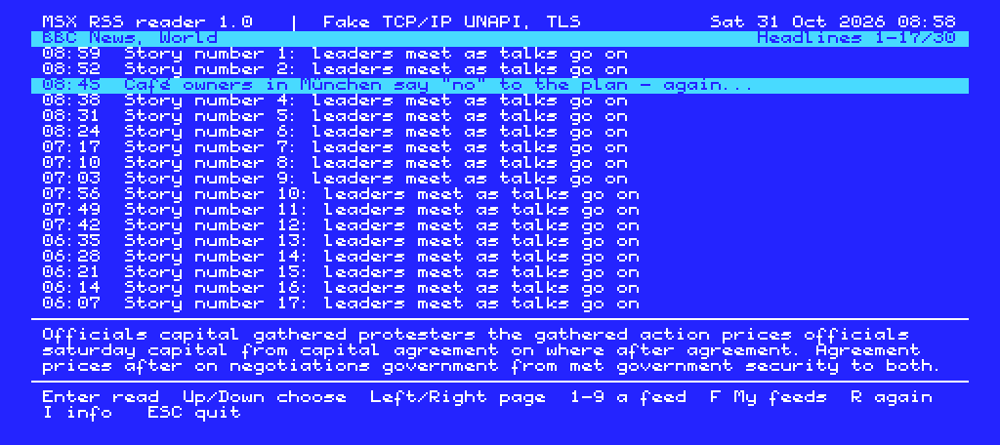
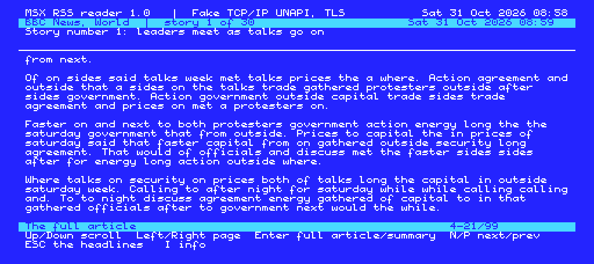
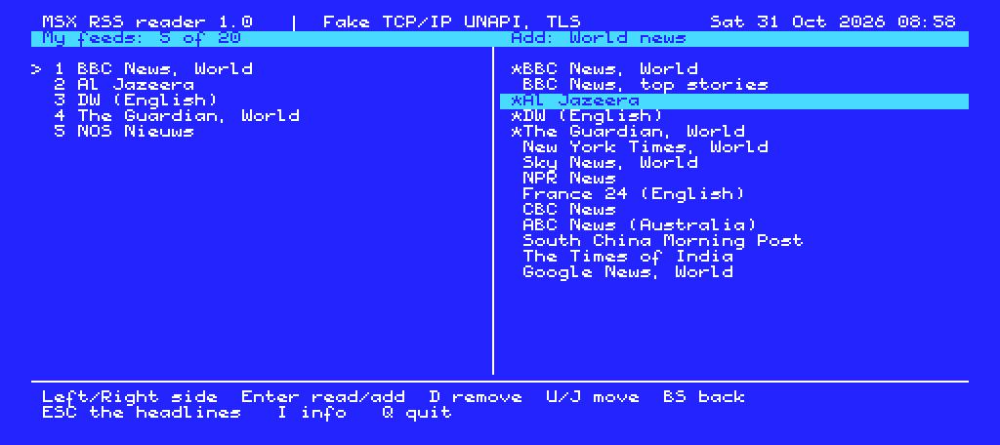
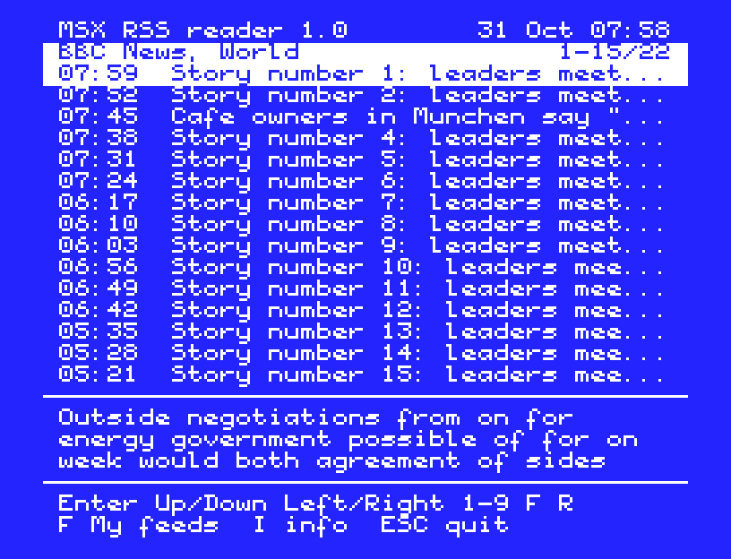

# MSX RSS reader

PicoAmp's news reader as a standalone program, for any MSX with a TCP/IP UNAPI network and for openMSX. The MSX does all of the work itself:

- the HTTP requests, with TLS for https (TCP/IP UNAPI 1.1);
- RSS 2.0, RSS 1.0 (RDF) and Atom, read as they come in;
- HTML to text, entities and UTF-8;
- the full article: the feed's `<content:encoded>`, or the `<p>` text of the story's web page.

It comes as two programs:

| File | For | Notes |
|---|---|---|
| `RSS.COM` | MSX-DOS 1, MSX-DOS 2, Nextor | Run `RSS`. |
| `RSS.ROM` | a 32 KB cartridge (plain, no mapper) | It starts once the disk system is ready, so RSS.INI is read from and saved to the boot disk. **Q** or **ESC** returns to BASIC. |

**Screen modes:**
- **MSX2, MSX2+ and turbo R:** 80 columns (TEXT 2, 26 rows), with the selection bars in the blink colours. Accents are shown in the MSX character set (é, ü, ñ, ...) on international machines.
- **MSX1:** 40 columns (TEXT 1, 24 rows), with inverted characters for the bars, plain ASCII, and fewer stories (16 KB VRAM).

The stories and the article are stored in VRAM (24 KB and 32 KB on an MSX2), so the ROM needs no RAM beyond page 3.






## Networks

Any TCP/IP UNAPI implementation works. The reader finds it through EXTBIO, wherever it lives: in a ROM, in a mapper segment through the RAM helper (as with the TSRs), or in page 3.

| Network | https |
|---|---|
| ESP8266 Wi-Fi with the UNAPI firmware (MSX-SM, SM-X and others, TCP/IP UNAPI 1.1 with TLS) | yes |
| openMSX 21 with [openMSXnet-tls](https://github.com/Jzzy-dev/openMSXnet-tls) (`UNAPINET.COM` under Nextor) | yes |
| openMSXnet (without TLS), GR8NET, Obsonet, DenYoNet, other implementations without TLS | http only, or https through the proxy (below) |

How https is handled:
- **The network has TLS:** https URLs use it. The host name goes along for SNI, and the certificate is not checked.
- **The network has no TLS:**
  - A `proxy=` line in RSS.INI sends https requests to [tools/rss_proxy.py](tools/rss_proxy.py), a small proxy that runs on a PC on your network.
  - Without a proxy, the reader tries the same URL over http. Many feeds still answer there; the BBC and DW feeds do. A site that sends you back to https gets the message "it needs https, the network has no TLS".

Stock openMSX has no network emulation. Use openMSXnet(-tls) for that.

## Keys

| View | Keys |
|---|---|
| Headlines | **Up/Down** choose, **Left/Right** a page, **Enter** the story, **1-9** a feed of My feeds, **F** or **BS** My feeds, **R** fetch again, **I** info, **ESC** quit |
| A story | **Up/Down** a line, **Left/Right** a page, **Enter** the full article / back to the summary, **N/P** next/previous story, **ESC** the headlines |
| My feeds | **Left/Right/TAB** the side, **Up/Down** choose, **Enter** read (left) / open a topic, add a feed (right), **D** or **DEL** remove, **U/J** move up/down, **BS** back, **ESC** the headlines |
| Info (I) | the network, TLS, the machine, the feed's state and error, memory, RSS.INI, the time zone; **ESC** back |

The full article comes in while you read it. The status bar shows the KB read, plus a percentage when the server gives a size.

## RSS.INI

On a computer with no disk, the reader starts with the default feeds and changes are not saved.

```
feeds=bbcw,alj,dw,guardw,nos
feed1=My own site|https://example.com/rss.xml
proxy=192.168.1.10:8088
tz=+60
```

- **`feeds=`** My feeds, in order (at most 20). The codes are those of the catalogue (`src/feeds_cat.c`: 110 feeds in 11 topics, the same as in PicoAmp). `#1`..`#9` refer to `feed1=`..`feed9=` lines with your own feeds. The reader rewrites this line when you change My feeds in the program. Without it, the default feeds apply, plus any `feedN=` lines.
- **`proxy=`** host:port of `rss_proxy.py`, used for https when the network has no TLS.
- **`tz=`** local time minus UTC, in minutes. Without it, an MSX2 works it out from its clock chip and the web's Date header. Times are shown in local time: "20:15" for today, "29 Oct" for an earlier day.

## The https proxy

```
python3 tools/rss_proxy.py 8088
```

It needs only the Python standard library. It fetches `GET https://...` requests over TLS and returns them as plain HTTP; redirects are passed on to the reader. Use it on your own network only, because it fetches whatever it is asked for.

## Building

```
./build.sh        # sjasmplus: RSS.COM and RSS.ROM (src/gen_cat.py makes cat.inc from feeds_cat.c)
```

The source is Z80 assembly for sjasmplus. It is assembled twice: at 0100h with variables at 8000h (COM), and at 4000h with variables at C000h (ROM). Nothing passed to the network is ever in page 1. These are the modules:

| File | |
|---|---|
| `rss.asm` | the start (COM, ROM header and H.STKE start), the main loop |
| `sys.asm` | BIOS, VDP/VRAM, text output, numbers, the clock, dates |
| `net.asm` | TCP/IP UNAPI (discovery, calls), the HTTP client (DNS, TLS, redirects, proxy) |
| `parse.asm` | the feed parser, HTML to text, the VRAM writer, dates |
| `text.asm` | word wrap and the line index |
| `feeds.asm` | RSS.INI, My feeds, the catalogue, fetching feeds and articles |
| `ui.asm` | the screens and keys |

## Tests

- **`test/z80_rss.c`** runs RSS.COM or RSS.ROM in a Z80 emulator with a small MSX around it. It provides the BIOS calls, FCB disk calls, a V9938 or TMS9918, the RTC, and a TCP/IP UNAPI answering from the fixture feeds in `test/fix`. The implementation can sit in a ROM, in page 3 or in a mapper segment, with or without TLS, and with a proxy.
- **`test/regress.sh`** runs 18 checks with it: every feed format, redirects, both kinds of full article, no TLS, the proxy, the three implementation kinds, the ROM, MSX1, My feeds saved, and the time zone. `test/vram2png.py` draws the screen.
- **`test/omsx/`** has a Tcl TCP/IP UNAPI implementation for openMSX (`unapi.tcl`, with `FAKEUNAPI.ROM`). It was used to test both programs on a real MSX2 BIOS with Nextor and with disk BASIC (the ROM's H.STKE start, RSS.INI saved on the disk).

This work is licensed under a "Creative Commons Attribution-NonCommercial-ShareAlike 4.0 International License", as PicoAmp is.
